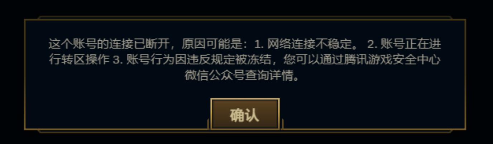
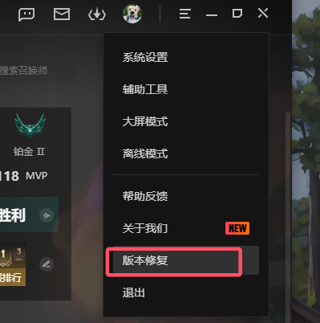
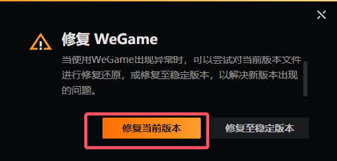
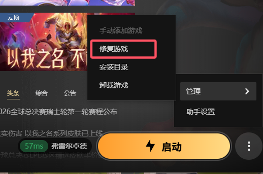

# 英雄联盟国服 ACE 报错（5 分钟一把）排查记录

**结论：重装 WeGame，再按下面 3 步修复，之后没有再出现"5 分钟一把"的问题。**

这是个人案例记录，不代表官方说法，但如果你的情况和我相似，可以先试这个方法。

## 问题

- 环境：Windows 10，WeGame 启动英雄联盟国服。
- 从 2026 年 10 月 16 日左右开始，游戏玩一会儿就提示"安全系统或数据被篡改"，然后被限制 5 分钟，基本是玩 5 分钟、封 5 分钟。
- 有时还会弹出"账号连接已断开"：

**可能的原因：我之前手动删过 ACE（腾讯的游戏反作弊组件）。** 删完之后就一直报错，单独重装游戏也补不回来。这一点是根据时间推断的，没有官方确认。

## 有效的修复方法

先卸载并重新安装 WeGame，然后按顺序做下面 3 步。

**1. WeGame 右上角菜单 → 版本修复**

**2. 在弹窗里选"修复当前版本"**

**3. 英雄联盟页面 → 启动按钮旁的"⋮" → 管理 → 修复游戏**

做完之后正常启动游戏，目前没有再出现 5 分钟限制。

## 试过但无效的方法

| 尝试 | 结果 |
| --- | --- |
| 让 Codex 根据报错信息检查并修复 | 失败 |
| 重装英雄联盟 | 失败 |
| 清理 DNS 缓存 | 启动后依旧报错 |
| 检查火绒是否拦截或限制 ACE | 没发现问题，报错依旧 |

我的理解是：问题出在 ACE 被删之后没有被正确补回，而 ACE 是跟着 WeGame 走的，所以只重装游戏没用，重装 WeGame 再修复才把它装回来了。这是推测，不确定。

欢迎在 Issues 里分享相同的报错和你的处理结果。
